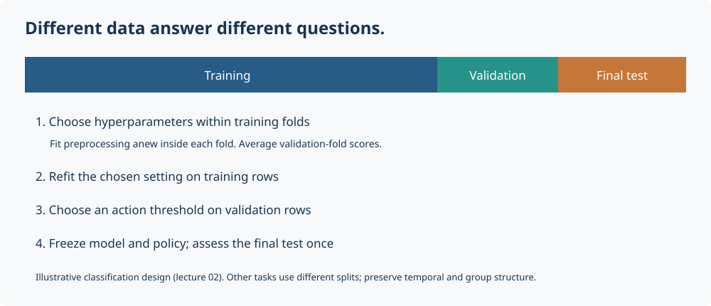

# Your first machine-learning experiment

You know Python and mathematics. You do not need to know pandas, scikit-learn, or machine-learning terminology before starting here.

## What are we trying to compute?

In supervised learning, one row is an observation. Its measured inputs are **features**, collected in a vector $x_i$. The quantity to predict is the **target** $y_i$. We choose a family of functions $f_\theta$, estimate its parameters from some observations, then measure prediction errors on observations kept out of fitting.

For housing, a row describes one synthetic house. Area and age are features; price is the target. Write $X\in\mathbb{R}^{n\times p}$ with observations in rows and features in columns, and $y\in\mathbb{R}^n$. A **sample** here means a row; a **dataset** contains many rows. Text and categorical inputs need numerical encoding before they become this matrix.

In numerical analysis, you may know the governing equation and study discretization error. Here the relation between input and output is partly unknown, and observations may be noisy. Minimizing training error alone does not establish accurate predictions on new observations. The sampling mechanism matters as much as the optimizer.

## The vocabulary you need first

| Term | Meaning in this course |
|---|---|
| Model / estimator | A rule with parameters that can be fitted to observations |
| Training set | Rows used to estimate parameters and learned preprocessing |
| Validation set | Separate rows used to choose settings or a decision threshold |
| Test set | Final assessment after choices are fixed |
| Hyperparameter | A setting chosen outside parameter fitting, such as tree depth or ridge strength |
| Generalization | Prediction performance on new observations from the relevant population |
| Overfitting | Adapting to training-specific variation that does not help new predictions |
| Baseline | A simple reference, such as always predicting the training mean |
| Leakage | Letting information unavailable at prediction time influence fitting or selection |
| Metric | A numerical summary of errors, such as RMSE; smaller is better for RMSE |

Cross-validation repeatedly partitions development data to estimate performance for model choices. It does not replace a final test assessment. Temporal and grouped observations need splits that respect their dependence; random row splitting is not universal.



The diagram follows lecture 02's design: internal cross-validation selects model settings; a separate validation partition selects the action rule. Fitted coefficients are parameters; settings such as regularization strength are hyperparameters. Keep the final test outside both choices.

## Know which tool does what

| Library | Role | First objects to recognize |
|---|---|---|
| NumPy | Numerical arrays and vectorized arithmetic | `ndarray`, `.shape`, `axis` |
| pandas | Labeled tables loaded from CSV files | `DataFrame`, column selection, missing values |
| Matplotlib | Figures for inspecting data and errors | `plt.subplots`, `ax.scatter`, `ax.plot` |
| scikit-learn | Splits, transformations, estimators, metrics | `train_test_split`, `Pipeline`, `.fit`, `.predict` |
| XGBoost | An implementation of gradient-boosted trees | `XGBRegressor`, validation history |

`df["price"]` selects a one-dimensional labeled Series. `df[["area_m2"]]` selects a two-dimensional table with one feature column. Scikit-learn generally expects `X.shape == (n_rows, n_features)` and `y.shape == (n_rows,)`. After encoding categories, the feature count can grow.

## A minimal complete experiment

Read the [installation instructions](../README.md), then run this from the repository root in the course Python environment:

```python
import pandas as pd
from sklearn.model_selection import train_test_split
from sklearn.linear_model import LinearRegression
from sklearn.dummy import DummyRegressor
from sklearn.metrics import mean_squared_error

houses = pd.read_csv("data/housing.csv")
X = houses[["area_m2"]]  # Keep the feature matrix two-dimensional.
y = houses["price"]
print(X.shape, y.shape)

X_train, X_test, y_train, y_test = train_test_split(
    X, y, test_size=0.2, random_state=42
)
baseline = DummyRegressor(strategy="mean")
model = LinearRegression()
for name, estimator in [("Training mean", baseline), ("Area-only line", model)]:
    estimator.fit(X_train, y_train)
    predictions = estimator.predict(X_test)
    rmse = mean_squared_error(y_test, predictions) ** 0.5
    print(f"{name}: test RMSE = {rmse:,.2f} price units")
```

`fit` changes the estimator: it learns parameters from training data. `predict` uses those learned parameters on another feature matrix; it does not refit. `random_state=42` makes the split repeatable; it does not make that split representative of every population.

This is a deliberately fixed, two-model demonstration with no hyperparameter selection. If you start selecting features or settings based on its test results, those rows have become validation data and you need fresh final test data.

**Pause and explain:** Why does the constant predictor use the training mean? What does RMSE measure, and what are its units? What information about houses does the area-only line ignore? A low error on synthetic houses cannot establish accuracy in a real housing market.

## Your first notebook, step by step

1. Download and unzip the **complete course**, or clone the repository. A notebook download alone does not include its CSV files.
2. Complete setup and launch `python -m jupyterlab` from the repository root.
3. Open `lectures/01_regression/lesson.ipynb`. Select the **Mathematical ML** kernel: the Python process that executes cells and holds their variables.
4. Run cells from top to bottom with **Shift+Enter**. Markdown cells explain the reasoning; code cells compute results. A running cell shows `[*]`.
5. When you change an early cell, rerun the dependent cells. Before trusting a result, choose **Kernel → Restart Kernel and Run All Cells** to check that it does not depend on stale variables.
6. Attempt `exercises.ipynb`, writing explanations as well as code. Then consult `solutions.ipynb`.

The website is a static reading view. Its code blocks do not execute Python. Your notebook runs locally, including its plots and printed results. The website labels conceptual illustrations separately from computed result snapshots. Each executed-result gallery links outputs back to the source cells and records the environment used to produce them.

## Read the estimator API as mathematics

| Operation | What it means | What it learns |
|---|---|---|
| `estimator.fit(X_train, y_train)` | Estimate model parameters | Coefficients, splits, or other fitted state |
| `transformer.fit(X_train)` | Estimate a representation | Means, scales, categories, vocabulary |
| `transformer.transform(X_new)` | Apply a fixed representation | Nothing new |
| `transformer.fit_transform(X_train)` | Fit and apply on training data | Representation state |
| `estimator.predict(X_new)` | Apply the fitted predictor | Nothing new |
| `classifier.predict_proba(X_new)` | Return one probability per class | Nothing new; inspect `.classes_` for column order |

A `Pipeline` composes transformations and an estimator. Its `.fit` learns each preprocessing stage using the supplied training rows, then fits the final model. A `ColumnTransformer` applies different transformations to named column groups and joins the resulting numerical features. Neither protects you from a badly chosen split or from preprocessing already fitted outside the pipeline.

An **epoch** is a full pass through data in some training algorithms; a **boosting round** adds a tree or stage. They are different ideas. A GPU changes how some computations run; it does not change which data are legitimate to use for fitting or evaluation.

## When something goes wrong

| Symptom | First check |
|---|---|
| `ModuleNotFoundError` | The notebook kernel should use the course environment, not another Python installation |
| CSV not found | Keep the complete course directory together; launch Jupyter from its root |
| `NameError` | Run earlier cells, then restart and run all if state is unclear |
| Wrong input shape | Inspect `X.shape`; select a list of columns to preserve two dimensions |
| A metric looks unexpectedly excellent | Check whether targets or future information leaked into the inputs or preprocessing |

Continue with [lecture 01: regression](../lectures/01_regression/README.md). Keep this page open as a reference; you do not need to memorize the APIs.
