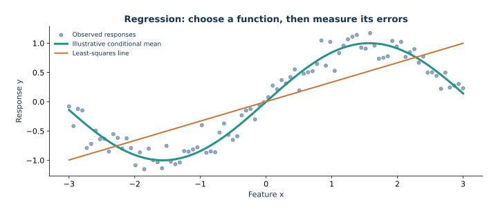

# 01 — Regression: predicting a numerical response

This lesson connects conditional-mean prediction, least squares, and Ridge regularization to a complete scikit-learn workflow on generated housing data. The examples make no claims about real homes or markets.

The route begins with the population squared-loss minimizer and normal equations. It then builds a preprocessing pipeline, explains what state each object learns during `fit`, and follows that state through `transform` and `predict`. A fixed small example isolates how Ridge `alpha` changes slopes. The main workflow selects alpha by training-only cross-validation and evaluates the frozen pipeline once against held-out baselines, then inspects residuals and coefficients.

The lesson states scikit-learn's sum-of-squares Ridge convention, explains why its intercept is not penalized, and connects scaling to the geometry of the penalty. The test partition is held out before preprocessing and model selection; imputation, scaling, and category encoding are learned within each cross-validation fold. MAE and RMSE use synthetic target units. $R^2$ is a relative squared-error comparison, not a causal or explanatory fraction.

## Open and run

Follow setup in the repository [README](../../README.md), then open `lesson.ipynb` in JupyterLab with the **Mathematical ML** kernel. It searches parent folders for `data/housing.csv`, so it works from the repository root or this lecture directory.

*Illustrative noisy response and two function families; this is not the housing model evaluation.*
