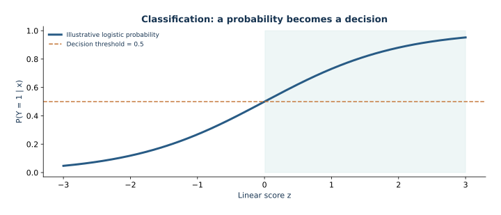

# 02 — Classification: predicting a binary outcome

This lesson connects Bernoulli likelihood and convex logistic regression to probability estimates, ranking metrics, calibration, and a cost-based decision threshold. It uses generated churn data that represent no real customers or retention program.

The route derives logistic loss, gradient, and Hessian, then builds a leakage-safe pipeline for numerical and categorical inputs. It explains how `fit`, `predict_proba`, and `predict` differ, and why probability, ranking, and thresholded actions answer separate questions. A fixed small example isolates scikit-learn's inverse regularization parameter `C`. The main workflow selects C by training-only cross-validation, inspects probability and classification behavior on validation data, chooses a threshold under stated toy costs, and evaluates the frozen choices once on the final test set.

For the installed `lbfgs` solver, the lesson connects C to the mathematical penalty, including fitting-row count and sample weights. It states the assumptions behind the cost threshold: calibrated probabilities, known constant costs, and unconstrained decisions. Generated-data performance cannot support customer interventions or causal claims.

## Open and run

Follow setup in the repository [README](../../README.md), then open `lesson.ipynb` in JupyterLab with the **Mathematical ML** kernel. It searches parent folders for `data/churn.csv`, so it works from the repository root or this lecture directory.

*Illustrative sigmoid and decision threshold; a probability and an action are different outputs.*
