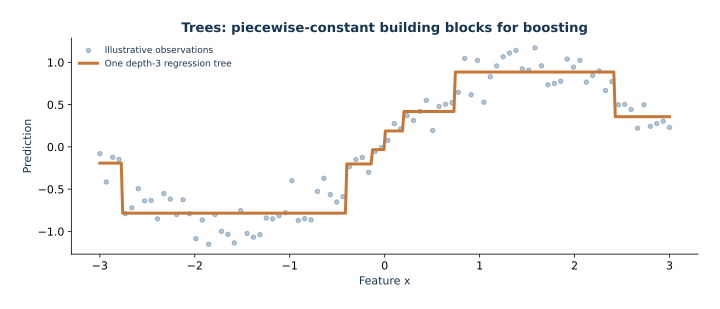

# 03 — XGBoost for regression

This lesson derives gradient-boosted trees as stagewise optimization in function space, then connects the regularized second-order objective to XGBoost's leaf and split controls. Its guided implementation compares XGBoost with a mean predictor and random forest on generated hourly bike-demand scenarios.

The route moves from residual fitting under squared loss to gradient/Hessian sums, regularized leaf values, and split gain. A parameter table explains settings used by the fitted model and how their effects depend on the objective. For squared-error regression, each row contributes unit Hessian under the conventional half-squared loss, so `min_child_weight` resembles a minimum child row count. Under logistic loss, Hessians depend on predicted probabilities. A small controlled example varies only `reg_lambda` to show how L2 changes leaf updates.

The scenarios are independent generated samples, not a chronological time series. A random train/validation/test split supports this teaching comparison, while the results do not estimate future-date performance. Validation drives early stopping; the final test partition is evaluated once afterward.

## Open and run

Follow setup in the repository [README](../../README.md), then open `lesson.ipynb` in JupyterLab with the **Mathematical ML** kernel. It searches parent folders for `data/bike_demand.csv`, so it works from the repository root or this lecture directory.

*An actual shallow tree fitted to an illustrative one-dimensional sample. Each leaf returns a constant.*
