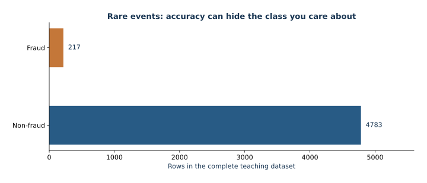

# 04 — Imbalanced learning: rare-event decisions

This lecture uses a locally generated transaction table and rare binary label; it represents no real bank or fraud process.

## Learning objectives

- Explain why accuracy hides minority-class failure and calculate prevalence.
- Derive logistic likelihood and interpret class-weighted risk.
- Compare unweighted and weighted logistic and XGBoost on common held-out rows.
- Distinguish AP, trapezoid PR area, ROC-AUC, prevalence, and calibration.
- Choose a threshold from validation costs and evaluate a frozen policy once on test.
- Explain class weighting's posterior-scale shift.

## Mathematical route

For $p_i=\sigma(x_i^T\beta)$, logistic negative log likelihood is $-\sum_i[y_i\log p_i+(1-y_i)\log(1-p_i)]$. Class weighting multiplies each term by $w_{y_i}$. Under ideal constant weights, the weighted optimum obeys $q/(1-q)=(w_1/w_0)p/(1-p)$, shifting odds and probabilities. AP weights precision by recall increments; trapezoid PR area interpolates curve points and generally differs. A no-skill PR precision reference is prevalence. ROC-AUC is a ranking summary, not a decision rule. For calibrated natural probability and constant costs, the Bayes threshold is $C_{FP}/(C_{FP}+C_{FN})$.

## Study steps

1. Read the course [setup](../../README.md), then read this README once before opening Jupyter.
2. Run `lesson.ipynb` top to bottom. Inspect prevalence before fitting and keep the test partition aside.
3. Trace the weighted-posterior derivation, then inspect the controlled weighting comparison and its cost interpretation.
4. Follow validation threshold selection; assess the frozen policy once on test data.

## Visual guide and study route

*Counts computed from the complete supplied fraud dataset, before splitting. The minority count explains why accuracy alone is insufficient.*

New to the libraries? Start with [the first-experiment walkthrough](../../docs/first-steps.md). Read the foundations, trace the annotated implementation, then compare the worked parameter examples. Allow about 2–3 hours for a first reading; detailed experiments may require another session.
