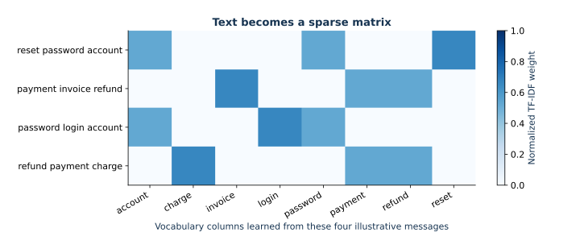

# 05 — Text classification with TF–IDF

This lecture routes short support requests into five categories using a weighted sparse text representation and multinomial logistic regression. It derives the vectorizer and classifier before building a baseline pipeline, selecting regularization on validation data, and inspecting errors and coefficients.

## Learning objectives

After the lesson, you should be able to:

- Derive scikit-learn's smoothed inverse document frequency and explain its default term-frequency and L2-normalization choices.
- Explain cosine similarity for unit-normalized sparse document vectors.
- Derive softmax probabilities, cross-entropy, and the multinomial logistic gradient.
- Fit a leakage-safe `TfidfVectorizer` + `LogisticRegression` pipeline and select its regularization using validation macro-F1.
- Read a confusion matrix, inspect errors, and interpret category coefficients with care.
- Explain why template-group separation prevents a specific kind of leakage and why this fixture is not a real-language benchmark.

## Setup and study steps

Use the root environment instructions in [the course README](../../README.md), including `python -m pip install -e .`. The lecture needs no model download or account. It uses the committed [synthetic ticket fixture](../../data/text_dataset.md).

Open JupyterLab at the repository root and select the **Mathematical ML** kernel. Read `lesson.ipynb` from top to bottom. It finds the repository by searching the current folder and its parents, so it also runs when opened from this lecture's folder. Continue through the guided representation comparisons. Each option table connects the API settings to the mathematical model. The notebook uses nbformat 4.5 with explicit cell IDs.

The split is deterministic and group-aware: 8 of each category's 12 template groups go to training, 2 to validation, and 2 to test. All eight variants from one group stay together, and the three splits have equal category counts. The pipeline fits vocabulary and IDF on training text during model selection. Candidate `C` values are compared on validation macro-F1; the selected model is refit on train plus validation and the final test is evaluated once. A most-frequent `DummyClassifier` is fit on the same development rows and compared on the identical test rows as a simple reference.

## Mathematical route

For $n$ documents and a term in $df_j$ documents, `TfidfVectorizer` with its defaults uses

$$\operatorname{idf}_j=\log\!\left(\frac{1+n}{1+df_j}\right)+1.$$

Its word analyzer lowercases, uses unigrams, and retains Unicode word tokens of at least two characters (`(?u)\b\w\w+\b`). There is no stop-word list or accent stripping by default. Raw term counts are multiplied by this IDF (`sublinear_tf=False`), then each nonzero row is L2 normalized. For normalized rows $u,v$, cosine similarity is their dot product $u^Tv$. The vectorizer produces sparse features because documents contain only a small part of the vocabulary.

For category logits $z_{ik}=w_k^Tx_i+b_k$, softmax produces $p_{ik}=e^{z_{ik}}/\sum_r e^{z_{ir}}$. With one-hot targets $y_{ik}$, average cross-entropy is $-n^{-1}\sum_i\sum_k y_{ik}\log p_{ik}$, whose slope gradient for class $k$ is $n^{-1}\sum_i(p_{ik}-y_{ik})x_i$. Scikit-learn adds an L2 coefficient penalty controlled inversely by `C`. Softmax is unchanged when the same vector is added to all class coefficients; pairwise log-odds depend on $(w_k-w_l)^Tx+(b_k-b_l)$.

## Scope and limitations

The 480 messages are authored synthetic examples with 60 template groups. This lesson can teach sparse text features, supervised classification, model selection, group leakage, and error analysis. Even a high score does not estimate accuracy on real, changing, imbalanced, multilingual, or sensitive support traffic. Coefficients describe this fitted model's logits and are not causal explanations. The lesson discusses pretrained embeddings conceptually as an alternative representation; it installs no embedding package and downloads no weights.

## Visual guide and study route

*Actual normalized TF-IDF weights for four illustrative messages. Rows are documents; columns are vocabulary items.*

New to the libraries? Start with [the first-experiment walkthrough](../../docs/first-steps.md). Read the foundations, trace the annotated implementation, then compare the worked parameter examples. Allow about 2–3 hours for a first reading; detailed experiments may require another session.
