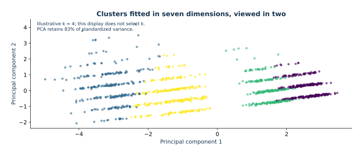

# 06 — Clustering: geometry, scaling, and PCA

This lesson clusters generated customer summaries. `segment_truth` is hidden from fitting and selection, and appears only in a post-hoc synthetic check.

## Learning objectives

- Derive K-means assignment and centroid steps and understand local minima.
- Explain how scaling changes distance geometry.
- Derive PCA's direction from a Rayleigh quotient and SVD.
- Use inertia and silhouette with their limits for selecting $k$.
- Separate full standardized-space clustering from PCA 2-D visualization.
- Explain label permutation and use ARI as post-hoc validation only.

## Mathematical route

K-means minimizes $\sum_i\|z_i-\mu_{c_i}\|^2$. Nearest-center assignment minimizes each row's term; differentiating the fixed-membership objective gives the cluster mean. Alternating decreases objective but the joint problem is nonconvex. The globally minimal inertia cannot rise with $k$ because an added center can reproduce an earlier solution. Finite randomized fits may still wiggle across $k$ when they reach different local optima. For centered $Z$, PCA's first direction maximizes $v^TZ^TZv$ under $v^Tv=1$, yielding the top eigenvector or right singular vector. Clustering here uses every standardized feature; PCA only supplies a display projection.

## Study steps

1. Follow [course setup](../../README.md), then read this guide before opening Jupyter.
2. Run `lesson.ipynb` in order. First inspect units, then fit clusters in all standardized dimensions.
3. Use PCA only for the two-dimensional display; inspect the k diagnostics before using any truth label.
4. Attempt `exercises.ipynb`, then compare with `solutions.ipynb`. The final ARI is post-hoc because this fixture is synthetic.

## Visual guide and study route

*Illustrative k=4 fit to all supplied customer features after standardization, projected to two principal components. This is not the later selected-k result.*

New to the libraries? Start with [the first-experiment walkthrough](../../docs/first-steps.md). Read the guided lesson, attempt the exercises, then consult solutions. Allow about 2–3 hours for a first reading; running experiments and completing exercises may require another session.
